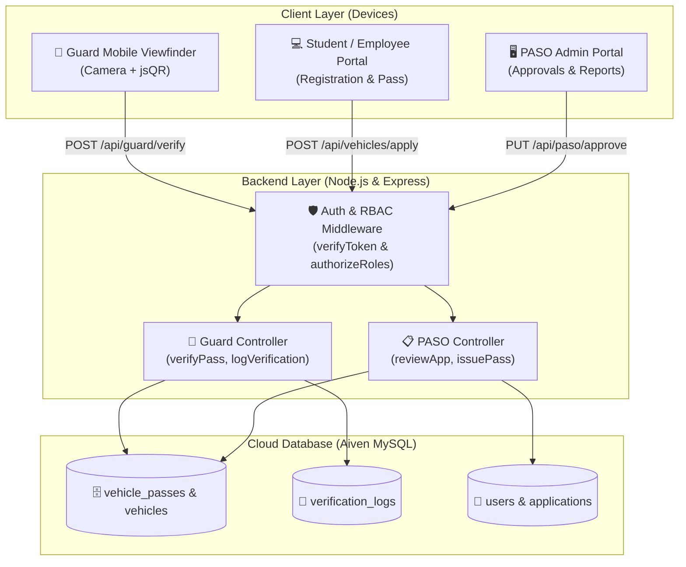

---
## 📌 Table of Contents
1. [System Architecture Overview](#1-system-architecture-overview)
2. [Deep Dive into Core & Critical Features](#2-deep-dive-into-core--critical-features)
- 2.1. [How Does the Optical QR Scanner Work in the Browser?](#21-optical-qr-code-scanning-engine)
- 2.2. [How Does the System Detect Fake, Meme, or Counterfeit QR Codes?](#22-qr-payload-validation--anti-fraud-detection)
- 2.3. [How Does the Scanner Fetch Verified Motorist Data from the Cloud Database?](#23-database-lookup--pass-clearance-verification)
- 2.4. [How Does Gate Audit Logging and Guard Accountability Work?](#24-gate-audit-logging--guard-accountability)
- 2.5. [How Does Academic Year Renewal Work Without Duplicate Pass Records?](#25-academic-year-renewal--loophole-fix)
- 2.6. [Cashier Official Receipt Verification & Digital Pass Issuance Pipeline](#26-cashier-receipt-verification--issuance-pipeline)
- 2.7. [Digital Visitor Management (Temporary Gate Pass System)](#27-digital-visitor-management)
- 2.8. [Admin Night Mode (Dark Mode) Architecture](#28-admin-night-mode-dark-mode-architecture)
3. [Source Code Directory & File Map](#3-source-code-directory--file-map)
4. [Top 20 Capstone Defense Panel Q&A Cheat Sheet](#4-top-20-capstone-defense-panel-qa-cheat-sheet)
5. [Project Conclusion](#5-project-conclusion)
---

## 1. System Architecture Overview

**RSU VPASS** is a modern Full-Stack Web Application engineered for the **Physical Assets and Security Office (PASO)** of Romblon State University:

- **Client Layer (Frontend):** React 19 Single Page Application (SPA) powered by Vite and Tailwind CSS v4. Fully responsive for guard mobile smartphones at campus gates and desktop monitors in the PASO administrative office.
- **Server Layer (Backend):** Node.js and Express RESTful API with Role-Based Access Control (RBAC) enforced via JSON Web Tokens (JWT).
- **Database Layer (Cloud):** TiDB Cloud-hosted MySQL database configured in 3rd Normal Form (3NF) (`users`, `vehicles`, `applications`, `vehicle_passes`, `temporary_passes`, `verification_logs`).



---

## 2. Deep Dive into Core & Critical Features

---

### 2.1. Optical QR Code Scanning Engine

#### ❓ Panel Question: _"Why does the scanner run directly in the browser? Did you use an external mobile application or dedicated scanner hardware?"_

> **Defense Answer:**  
> _"We do not require dedicated hardware barcode scanners or native mobile apps (such as APKs). The scanner utilizes the standard **HTML5 WebRTC MediaStream API** alongside the open-source **`jsQR`** pure JavaScript library. It runs directly within mobile web browsers (Google Chrome or Safari) on any Android or iOS smartphone used by the on-duty security guard."_

#### 📂 Source Code Location:

- **File:** [`client/src/pages/guard/GuardScanner.jsx`](file:///c:/Users/ADMIN/OneDrive/Desktop/web%20development/rsuv-vpass/client/src/pages/guard/GuardScanner.jsx)
- **Key Functions:** `startCamera()`, `scanFrame()`, `handleScannedData()`

#### ⚙️ Step-by-Step Technical Process:

1. **Camera Stream Acquisition:** Upon loading the Guard Scanner, `navigator.mediaDevices.getUserMedia({ video: { facingMode: { ideal: "environment" } } })` requests permission to activate the device's rear environment camera.
2. **Hidden Canvas Frame Grabber:** The live video feed is piped into a hidden HTML5 `<canvas>` element.
3. **Continuous Real-Time Frame Processing (60 FPS):** Using `requestAnimationFrame(scanFrame)`, each individual frame is captured as raw pixel data via `ctx.getImageData(0, 0, width, height)`.
4. **Binarization & Pattern Decoding:** Pixel data is processed by `jsQR(imageData.data, width, height)`. Once the 3 finder square patterns of a QR code are recognized, it decodes the matrix into a raw string payload (`qr.data`).
5. **Haptic & Audio Feedback:** On successful detection, the device emits an audible validation chime and triggers physical vibration feedback using `navigator.vibrate([40, 30, 40])`.

---

### 2.2. QR Payload Validation & Anti-Fraud Detection

#### ❓ Panel Question: _"What happens if someone scans a random QR code found online, a GCash payment QR, or an external link? How does the system detect fraud?"_

> **Defense Answer:**  
> _"The system uses a **Three-Tier Validation Architecture**:_
>
> 1. _Standardized Signature Prefix Check (`RSU-VPASS:` syntax)._
> 2. _External Media & Meme Link Trap (detects URL redirects, Rickrolls, and malicious links)._
> 3. _Real-Time Cloud Database Cryptographic Integrity Matching."_

#### 📂 Source Code Location:

- **Frontend Validation:** [`client/src/pages/guard/GuardScanner.jsx`](file:///c:/Users/ADMIN/OneDrive/Desktop/web%20development/rsuv-vpass/client/src/pages/guard/GuardScanner.jsx#L700-L750)
- **Backend Verification:** [`server/controllers/guardController.js`](file:///c:/Users/ADMIN/OneDrive/Desktop/web%20development/rsuv-vpass/server/controllers/guardController.js#L25-L107) (`verifyPass`)

#### 🛡️ Official QR Payload Standard:

All genuine RSU VPASS vehicle stickers follow a strict internal structure:
$$\text{Payload} = \texttt{RSU-VPASS:<PassNumber>:<CleanPlateNumber>:<Category>}$$

_Examples:_

- Student Pass: `RSU-VPASS:S-001:MV123:STUDENT`
- Employee Pass: `RSU-VPASS:E-081:XYZ5678:EMPLOYEE`
- Temporary Visitor Pass: `RSU-VPASS:TMP-2026-4130:NBM123:VISITOR`

#### 🚨 How Fraud, Memes, and Fake Codes Are Blocked:

1. **External Link & Meme URL Trap:**  
   If the scanned code begins with `http://` or `https://` (e.g. YouTube meme videos, social media links, or external websites):
   - The scanner traps the input via `isMemeOrMedia`.
   - It sounds an alert buzzer and renders a high-priority warning modal:  
     _"External Media / Meme QR Detected (Troll Code) — The scanned QR code links to an external image, video, or social media page instead of a verified campus vehicle pass."_
2. **Random Text / Unregistered QR (GCash, Wi-Fi, etc.):**
   - Any code lacking the `RSU-VPASS:` signature or valid alphanumeric pass number is sent to `/api/guard/verify`.
   - If no matching active record exists in `vehicle_passes` or `temporary_passes`, it triggers:  
     _"Unregistered / Counterfeit QR Code — This code is not an official RSU Vehicle Pass."_
3. **Expired Sticker Pass:**
   - Even if the sticker was genuine in the past, if `valid_until` has expired relative to the server timestamp, it renders a high-visibility red **EXPIRED PASS** modal, denying campus entry.

---

### 2.3. Database Lookup & Pass Clearance Verification

#### ❓ Panel Question: _"What occurs in the database immediately after a valid QR code is scanned?"_

> **Defense Answer:**  
> _"Once the QR string is decoded, the frontend dispatches a secure POST request to `/api/guard/verify`. The backend executes an optimized multi-table `SQL JOIN` across `vehicle_passes`, `vehicles`, `users`, and `applications` to retrieve the latest motorist profile and vehicle specifications."_

#### 📂 Source Code Location:

- **Backend Route:** [`server/routes/guardRoutes.js`](file:///c:/Users/ADMIN/OneDrive/Desktop/web%20development/rsuv-vpass/server/routes/guardRoutes.js#L21)
- **Controller Logic:** [`server/controllers/guardController.js`](file:///c:/Users/ADMIN/OneDrive/Desktop/web%20development/rsuv-vpass/server/controllers/guardController.js#L40-L75)

#### 🔍 The Optimized SQL Query:

```sql
SELECT
  vp.id as pass_id, vp.pass_number, vp.valid_until, vp.academic_year, vp.template_version, vp.status,
  v.plate_number, v.vehicle_type, v.make, v.model, v.color, v.year_model,
  u.full_name, u.school_id, COALESCE(a.applicant_photo, u.photo_url) as client_photo, u.contact_number,
  u.classification, u.year_course, u.department_unit
FROM vehicle_passes vp
JOIN vehicles v ON vp.vehicle_id = v.id
JOIN users u ON vp.user_id = u.id
LEFT JOIN applications a ON a.vehicle_id = v.id
WHERE vp.pass_number = ?
   OR vp.qr_code_data = ?
   OR REPLACE(UPPER(v.plate_number), ' ', '') = ?
ORDER BY vp.id DESC
LIMIT 1;
```

#### 📋 Information Displayed on the Guard's Clearance Screen:

- **Motorist Photo:** High-resolution 2x2 identification photo to verify that the driver matches the registered owner.
- **Pass Details:** Pass Number (e.g., `S-001`), Academic Year (`2026-2027`), Status (`ACTIVE`).
- **Owner Information:** Full Name, School ID / Employee ID, Academic Department or Course.
- **Vehicle Specifications:** Make & Model (e.g., _Yamaha Aerox 155_), Color, Plate Number, and Vehicle Type.

---

### 2.4. Gate Audit Logging & Guard Accountability

#### ❓ Panel Question: _"How does the PASO Administrator know which guard scanned a specific vehicle or admitted a visitor?"_

> **Defense Answer:**  
> _"Every security guard logs in with a dedicated account (`role: 'GUARD'`). Their JSON Web Token (JWT) contains their unique `guard_id`. Every time an entry, exit, or spot-check verification occurs, the backend automatically binds this ID to the `verification_logs` record. In the Admin Reports & Logs interface, a dedicated **'Verified By Guard'** column displays the full name of the on-duty guard."_

#### 📂 Source Code Location:

- **Database Table:** `verification_logs` (schema: [`server/database/schema.sql`](file:///c:/Users/ADMIN/OneDrive/Desktop/web%20development/rsuv-vpass/server/database/schema.sql#L127-L141))
- **Backend Logging:** [`server/controllers/guardController.js`](file:///c:/Users/ADMIN/OneDrive/Desktop/web%20development/rsuv-vpass/server/controllers/guardController.js#L560-L585) (`logVerification`)
- **Admin Display:** [`client/src/pages/admin/AdminReports.jsx`](file:///c:/Users/ADMIN/OneDrive/Desktop/web%20development/rsuv-vpass/client/src/pages/admin/AdminReports.jsx#L480-L560)

#### 🛡️ Anti-Duplicate Double-Scan Protection:

To prevent duplicate logs when a camera remains pointed at a sticker, the system enforces a **4-second database debounce constraint**:

```javascript
// Checks if an identical log was recorded within the last 4 seconds
const [recentLogs] = await pool.query(
  `
  SELECT id FROM verification_logs 
  WHERE (pass_number = ? OR plate_number = ?)
    AND verification_type = ?
    AND timestamp >= NOW() - INTERVAL 4 SECOND
  LIMIT 1
`,
  [passNum, plate, vType],
);

if (recentLogs.length > 0) {
  return res.status(200).json({ message: "Duplicate log suppressed" });
}
```

---

### 2.5. Academic Year Renewal & Loophole Fix

#### ❓ Panel Question: _"When the Admin changes the Academic Year (e.g., from 2026-2027 to 2027-2028) and a student renews their pass for the same vehicle, does it create a duplicate pass or update the existing one?"_

> **Defense Answer:**  
> _"We resolved this critical vulnerability by enforcing a **One-Vehicle-One-Pass Constraint** at the database level (`UNIQUE(vehicle_id)`). When an existing vehicle is renewed for a new Academic Year, the system performs an **in-place atomic update** on the existing record: updating `academic_year`, extending `valid_until`, and issuing the new annual sticker template version without duplicating records for the same plate number."_

#### 📂 Source Code Location:

- **Sequential Pass Ordering:** [`client/src/context/PassContext.jsx`](file:///c:/Users/ADMIN/OneDrive/Desktop/web%20development/rsuv-vpass/client/src/context/PassContext.jsx#L260-L310) (`getSequentialPassNumber`)
- **Backend Pass Upsert:** [`server/controllers/pasoController.js`](file:///c:/Users/ADMIN/OneDrive/Desktop/web%20development/rsuv-vpass/server/controllers/pasoController.js)

---

### 2.6. Cashier Receipt Verification & Issuance Pipeline

#### ❓ Panel Question: _"Why is cashier receipt verification mandatory before a QR pass is issued?"_

> **Defense Answer:**  
> _"This aligns with official RSU PASO and University Cashier compliance policies. Vehicle pass stickers require an official fee. After applying online and passing PASO preliminary document verification, motorists pay at the Cashier. They upload their Official Receipt (OR) photo and input their OR Number. The PASO Administrator verifies the receipt image before generating the official QR pass."_

#### 📂 Source Code Location:

- **Client Receipt Upload:** [`client/src/pages/client/Payments.jsx`](file:///c:/Users/ADMIN/OneDrive/Desktop/web%20development/rsuv-vpass/client/src/pages/client/Payments.jsx)
- **Admin Review & Approval:** [`client/src/pages/admin/AdminApplications.jsx`](file:///c:/Users/ADMIN/OneDrive/Desktop/web%20development/rsuv-vpass/client/src/pages/admin/AdminApplications.jsx)
- **Client-Side Compression:** [`client/src/utils/imageCompressor.js`](file:///c:/Users/ADMIN/OneDrive/Desktop/web%20development/rsuv-vpass/client/src/utils/imageCompressor.js) (Compresses large camera uploads to <500KB to prevent browser memory exhaustion).

---

### 2.7. Digital Visitor Management

#### ❓ Panel Question: _"How does the system manage campus guests, delivery drivers, or temporary contractors who do not possess an annual sticker?"_

> **Defense Answer:**  
> _"The Guard Scanner includes a built-in **Visitor Hub Desk**. Guards can register and issue a Digital Temporary Visitor Pass valid for 1 to 7 days, generating a unique QR code (`TMP-2026-XXXX`). When the guest exits the campus through any gate, the guard scans the QR code or plate number to record their **EXIT** timestamp, automatically updating their status from `INSIDE` to `EXITED`."_

#### 📂 Source Code Location:

- **Frontend Visitor Desk:** [`client/src/pages/guard/GuardScanner.jsx`](file:///c:/Users/ADMIN/OneDrive/Desktop/web%20development/rsuv-vpass/client/src/pages/guard/GuardScanner.jsx#L1540-L1890)
- **Backend Endpoints:** [`server/routes/guardRoutes.js`](file:///c:/Users/ADMIN/OneDrive/Desktop/web%20development/rsuv-vpass/server/routes/guardRoutes.js#L28-L32) (`/api/guard/visitor-pass`, `/visitors/:id/exit`)

---

### 2.8. Admin Night Mode (Dark Mode) Architecture

#### ❓ Panel Question: _"How was the Dark Mode / Night Mode feature engineered in the Admin portal?"_

> **Defense Answer:**  
> _"We implemented class-based theme scoping (`html.dark`) powered by CSS design tokens and persistent `localStorage` synchronization. Clicking the Sun/Moon toggle in the top-right header toggles the `.dark` class on the root `<html>` document. All cards, tables, inputs, sidebars, and badges transition seamlessly to a deep slate palette (`#090d16` and `#0f172a`) adhering to WCAG 2.1 AA accessibility contrast guidelines."_

#### 📂 Source Code Location:

- **Toggle Button & State:** [`client/src/components/Navbar.jsx`](file:///c:/Users/ADMIN/OneDrive/Desktop/web%20development/rsuv-vpass/client/src/components/Navbar.jsx)
- **Theme Lifecycle & Cleanup:** [`client/src/layouts/AdminLayout.jsx`](file:///c:/Users/ADMIN/OneDrive/Desktop/web%20development/rsuv-vpass/client/src/layouts/AdminLayout.jsx)
- **Dark Theme Stylesheet:** [`client/src/index.css`](file:///c:/Users/ADMIN/OneDrive/Desktop/web%20development/rsuv-vpass/client/src/index.css#L60-L244)

---

## 3. Source Code Directory & File Map

When panelists request: **"Open the file where this logic is implemented"**, refer directly to this directory map:

| Feature / Panel Inquiry                  | Source Code File Path                     | Key Function / Variable                          |
| :--------------------------------------- | :---------------------------------------- | :----------------------------------------------- |
| **Camera Feed & QR Decoder**             | `client/src/pages/guard/GuardScanner.jsx` | `startCamera()`, `scanFrame()`, `jsQR`           |
| **Fake QR & Meme Trap Detection**        | `client/src/pages/guard/GuardScanner.jsx` | `handleScannedData()`, `setInvalidScanAlert`     |
| **Database Pass Verification Logic**     | `server/controllers/guardController.js`   | `verifyPass()`                                   |
| **Gate Entry/Exit Logs Insertion**       | `server/controllers/guardController.js`   | `logVerification()`                              |
| **Guard Name Tracking in Logs**          | `server/controllers/guardController.js`   | `getRecentLogs()` (`COALESCE(u.full_name)`)      |
| **Admin Reports & Excel Export**         | `client/src/pages/admin/AdminReports.jsx` | `handleDownloadReport()`, `filteredLogs`         |
| **Sequential Numbering (S-001 / E-001)** | `client/src/context/PassContext.jsx`      | `getSequentialPassNumber()`                      |
| **Receipt Verification & Issuance**      | `server/controllers/pasoController.js`    | `verifyReceiptAndIssuePass()`                    |
| **Temporary Visitor Pass Logic**         | `server/controllers/guardController.js`   | `createTemporaryPass()`, `logVisitorExitEvent()` |
| **JWT Token Generation & Auth**          | `server/controllers/authController.js`    | `login()`, `jwt.sign()`                          |
| **Role-Based Access Control (RBAC)**     | `server/middleware/roleMiddleware.js`     | `authorizeRoles('GUARD', 'PASO_ADMIN')`          |
| **Database Schema Definition**           | `server/database/schema.sql`              | `verification_logs`, `vehicle_passes`            |
| **Aiven Cloud MySQL Connection Pool**    | `server/config/db.js`                     | `mysql.createPool()`, SSL config                 |
| **Admin Night Mode Toggle**              | `client/src/components/Navbar.jsx`        | `toggleDarkMode()`, `isDarkMode`                 |
| **Dark Theme Global Styling**            | `client/src/index.css`                    | `html.dark`, surface tokens                      |

---

## 4. Top 20 Capstone Defense Panel Q&A Cheat Sheet

---

#### 💡 Q1: _"Why did you choose QR Codes over RFID tags or ANPR (Automatic Number Plate Recognition) cameras?"_

> **Answer:**  
> _"We evaluated three criteria: **cost-efficiency, accessibility, and operational feasibility**.  
> RFID systems require expensive specialized reader antennas at every gate, along with individual physical tags for thousands of students and employees. ANPR camera systems require high-resolution night-vision cameras, complex lighting infrastructure, and costly GPU processing servers.  
> In contrast, QR code stickers are highly durable, cost pennies to print, and allow guards to use their existing smartphones without requiring any specialized hardware investments from the university."_

---

#### 💡 Q2: _"What prevents a student from taking a screenshot of someone else's QR code sticker and presenting it on their phone?"_

> **Answer:**  
> \*"Our system enforces **Two-Factor Visual Verification**.  
> Scanning a pass does not merely yield a 'Valid' message. The guard's screen instantly displays:
>
> 1. The registered owner's **official 2x2 identification photo**.
> 2. The exact **Plate Number, Make, Model, and Color** of the authorized vehicle.  
>    If an Aerox sticker is scanned, but the driver arrives on a Honda Click, or if the driver does not match the photo on the clearance screen, the guard immediately intercepts the motorist."\*

---

#### 💡 Q3: _"What happens if internet connectivity fluctuates or drops at the campus gate?"_

> **Answer:**  
> _"The application incorporates a **Local Cache & Offline Synchronization Layer** via browser `localStorage` and memory state retention in `PassContext.jsx`. The guard scanner pre-fetches active pass lists during shift initialization. If temporary connectivity lag occurs, manual verification remains functional against cached data, and generated audit logs sync back to the Aiven Cloud Database once connectivity stabilizes."_

---

#### 💡 Q4: _"How do you prevent duplicate scan logs when the camera remains focused on a QR code?"_

> **Answer:**  
> \*"We implemented **Multi-Tier Anti-Bounce Protection**:
>
> 1. **Client-Side Debouncing (`PassContext.jsx`):** An in-memory reference (`lastGateLogRef`) discards identical pass numbers submitted within 3.5 seconds.
> 2. **Server-Side SQL Debounce (`guardController.js`):** At the database tier, the server checks if an identical pass or plate record was written at that gate within the last 4 seconds (`timestamp >= NOW() - INTERVAL 4 SECOND`). Duplicate inserts are silently suppressed with an HTTP 200 acknowledgment."\*

---

#### 💡 Q5: _"What normalization level does your database schema adhere to?"_

> **Answer:**  
> \*"Our database strictly adheres to **Third Normal Form (3NF)**:
>
> - We separated concerns into distinct normalized entities: `users` (profiles), `vehicles` (plates and specs), `applications` (documents and receipts), and `vehicle_passes` (active QR passes).
> - Every table has a distinct Primary Key, and repeating groups are eliminated (1NF).
> - All non-key attributes are fully dependent on the primary key (2NF).
> - Transitive dependencies are removed (3NF)—for example, vehicle attributes are not stored within the user table, but rather referenced via foreign keys."\*

---

#### 💡 Q6: _"How do you secure user passwords and authentication tokens?"_

> **Answer:**  
> _"We utilize **bcryptjs** with 10 salt rounds for irreversible password hashing; plain-text passwords are never stored. For session security, we employ **JSON Web Tokens (JWT)** with 7-day expiration windows. Protected routes pass through our `verifyToken` middleware, which verifies the cryptographic signature before executing any controller action."_

---

#### 💡 Q7: _"What stops a student from navigating to Admin or Guard endpoints?"_

> **Answer:**  
> _"Our backend enforces strict **Role-Based Access Control (RBAC)** via `server/middleware/roleMiddleware.js`. We establish three roles: `CLIENT`, `GUARD`, and `PASO_ADMIN`.  
> Even if a student manually sends HTTP requests to administrative endpoints (such as `/api/paso/applications`), the middleware inspects the decoded token payload and rejects unauthorized access with an `HTTP 403 Forbidden` response."_

---

#### 💡 Q8: _"How is sequential pass numbering (e.g., S-001, E-001) calculated?"_

> **Answer:**  
> _"The logic resides in `getSequentialPassNumber()` in `PassContext.jsx`.  
> The system checks user classification: Students receive the **'S-'** prefix; Employees receive **'E-'**.  
> The system collects all existing issued sequence numbers into a `Set` to prevent collisions. It then iterates incrementally starting from 1 (e.g. 1 $\to$ 001, 2 $\to$ 002) to assign the next available sequential number, ensuring no gaps or duplicates."_

---

#### 💡 Q9: _"What if a student uploads an unreadable or tampered vehicle document (OR/CR)?"_

> **Answer:**  
> _"The registration workflow requires **Administrative Verification**. Uploaded documents are stored securely in cloud storage and displayed via high-resolution image viewers for the PASO Administrator. If an image is unreadable or fraudulent, the Admin uses the **Reject Application** tool with an itemized explanation (e.g., 'Certificate of Registration photo is blurry, please re-upload')."_

---

#### 💡 Q10: _"Why must students upload a Cashier Official Receipt (OR)?"_

> **Answer:**  
> _"Annual vehicle stickers require university trust fund fee payment. To satisfy **Commission on Audit (COA)** compliance, the count of issued vehicle passes must reconcile directly with Cashier revenue records. Requiring the OR number and receipt photograph ensures every released pass correlates with verified university payment."_

---

#### 💡 Q11: _"How does the system handle high-resolution image uploads without exhausting server bandwidth or storage?"_

> **Answer:**  
> _"We integrated client-side image compression in [`client/src/utils/imageCompressor.js`](file:///c:/Users/ADMIN/OneDrive/Desktop/web%20development/rsuv-vpass/client/src/utils/imageCompressor.js).  
> Prior to API transmission, images are automatically scaled on an off-screen HTML5 Canvas to a maximum dimension of 1200px at 75% quality. This reduces raw 5MB–10MB phone camera photos down to 150KB–350KB while preserving document legibility."_

---

#### 💡 Q12: _"How does the system track when a visitor departs from the university?"_

> **Answer:**  
> _"Through our **Visitor Exit Protocol**:  
> When a guest exits through any campus gate, the security guard scans their Temporary QR Pass or searches their plate number and taps 'Record Exit'. The client dispatches a `PUT /api/guard/visitors/:id/exit` request, updating the pass status from `INSIDE` to `EXITED`, logging the exit gate and timestamp, and updating the live dashboard counter."_

---

#### 💡 Q13: _"What happens if a guard switches mobile devices mid-shift?"_

> **Answer:**  
> _"Because RSU VPASS is a **Cloud-Native Web Application**, session state is not tied to a single physical device. The guard opens any standard web browser on the replacement phone, signs into their guard account, and selects their gate station (e.g., Gate 2). All gate logs and pass statuses synchronize in real-time via the cloud database."_

---

#### 💡 Q14: _"How do you guarantee that log timestamps are accurate across different devices?"_

> **Answer:**  
> _"Timestamps are recorded in ISO 8601 UTC format at the database tier and parsed on the frontend explicitly configured to the **`Asia/Manila`** timezone (Philippine Standard Time, UTC+8). This prevents discrepancies caused by mismatched device system clocks."_

---

#### 💡 Q15: _"Why did you include an Excel (.xlsx) Export feature in the Admin portal?"_

> **Answer:**  
> _"University administrations routinely require formal documentation for monthly security audits, compliance, and board meetings. Our utility in [`client/src/utils/excelExport.js`](file:///c:/Users/ADMIN/OneDrive/Desktop/web%20development/rsuv-vpass/client/src/utils/excelExport.js) generates standardized spreadsheets containing complete audit logs: Date, Time, Action, Gate Station, Plate Number, Driver Name, Pass Reference, Security Status, and the Verifying Guard."_

---

#### 💡 Q16: _"What is the difference between 'CHECK', 'ENTRY', and 'EXIT' in the audit logs?"_

> **Answer:**  
> _"**'ENTRY'** and **'EXIT'** are applied to Employees and Campus Visitors to establish their active physical presence on campus.  
> Students, who frequently travel between gates throughout the academic day, are audited under **'CHECK' (Spot-Check)**. This verifies sticker authenticity and authorized clearance without imposing restrictive time-in/time-out constraints."_

---

#### 💡 Q17: _"What if a power outage occurs at the guard station?"_

> **Answer:**  
> _"The Guard Scanner runs on battery-powered mobile smartphones using cellular mobile data, allowing continuous operations during electrical blackouts. Furthermore, the scanner includes a built-in **Torch / Flashlight Toggle** so guards can scan windshield and fender stickers in low-light or nighttime conditions."_

---

#### 💡 Q18: _"Can an unauthorized person forge a pass using an online QR code generator?"_

> **Answer:**  
> _"No. Even if an individual generates a QR code with the text 'RSU-VPASS', scanning the code prompts the backend to verify the `pass_number` and `plate_number` against approved, paid records in the Aiven Cloud MySQL database. If no matching active record exists, the system flags the code as **'Invalid / Counterfeit QR'**."_

---

#### 💡 Q19: _"How did you resolve the Dark Mode UI blending bug where badge numbers disappeared?"_

> **Answer:**  
> _"The bug was caused by a contrast conflict: in dark mode, text colors were styled to light slate (`#cbd5e1`), but the background class (`bg-slate-200`) remained light gray (`#e2e8f0`). Light gray text over a light gray background resulted in zero contrast, rendering the numbers invisible. We resolved this by introducing dedicated `.dark` CSS tokens: inactive badge backgrounds shift to dark slate (`#1e293b`) with a 1px border (`#334155`), ensuring sharp contrast and complete legibility."_

---

#### 💡 Q20: _"What are your technical recommendations for Future Work?"_

> **Answer:**  
> \*"For future expansion, we recommend:
>
> 1. **Automated Barrier Integration (IoT Relays):** Connecting microcontrollers (e.g. ESP32 or Arduino) to trigger automated boom barriers upon QR verification.
> 2. **SMS Gateway Alerts:** Dispatching automated text alerts to motorists when their sticker pass is approved, expired, or flagged for a security check.
> 3. **AI Helmet & Speed Compliance:** Incorporating lightweight computer vision models at the gate to detect helmet safety compliance for incoming motorcyclists."\*

---

## 5. Project Conclusion

**RSU VPASS** provides a robust, modern, and transparent campus security management platform for Romblon State University:

- Eliminates manual paper logbooks vulnerable to falsification.
- Prevents unauthorized campus entry and counterfeit sticker usage.
- Establishes complete accountability for every gate officer and vehicle transaction.
- Delivers enterprise-grade capabilities using lightweight web technologies without requiring costly specialized hardware.
